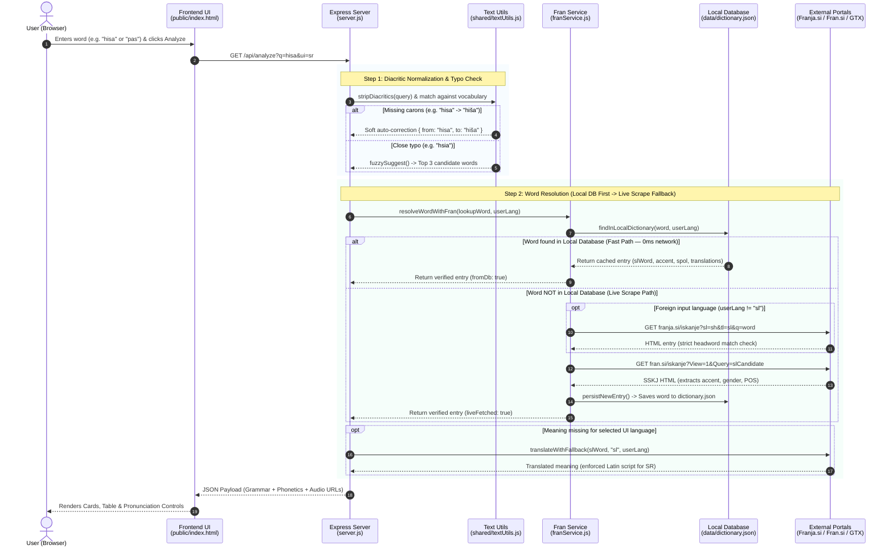
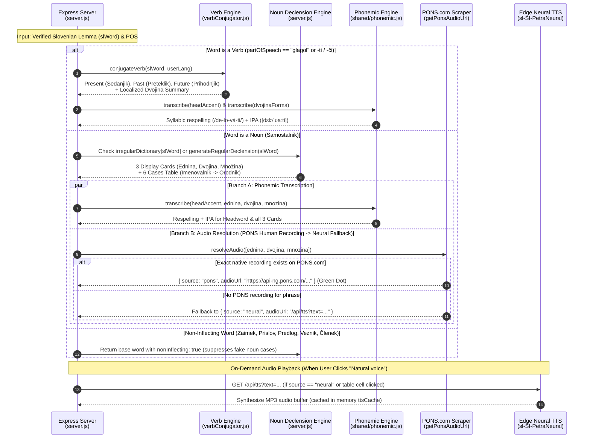
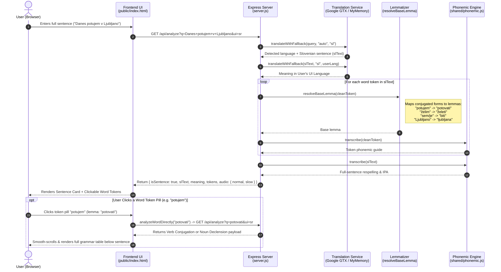
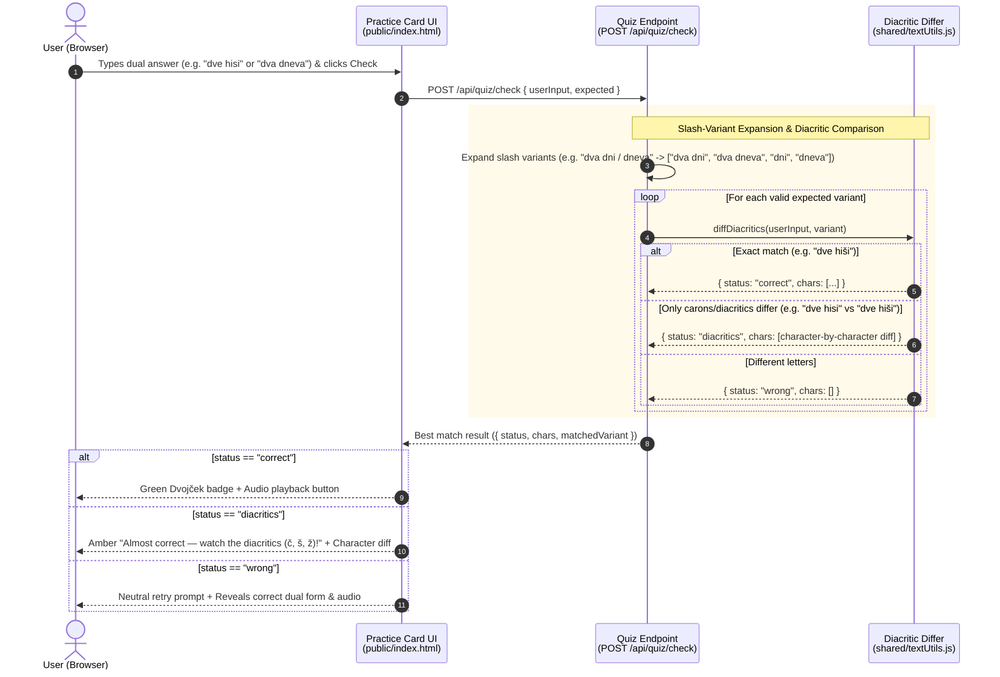

# Dvojček — System Architecture & Sequence Diagrams

> [!NOTE]
> **Zero Runtime AI Token Cost:** All translation resolution, dictionary lookups, Slovenian noun declensions (6 cases across *Ednina*, *Dvojina*, *Množina*), verb conjugations, phonemic IPA transcriptions, and audio synthesis run via deterministic Node.js modules and HTTP APIs — consuming **0 LLM/AI tokens** at runtime.

---

## 1. End-to-End Word Lookup & Self-Growing Dictionary Flow

This sequence diagram illustrates what happens when a user searches for a single word (e.g., `"pas"`, `"hisa"`, `"delovati"`), showing how the local database ([`data/dictionary.json`](file:///E:/antigravity/Translator%20app/data/dictionary.json)) is checked first before falling back to live scraping of **Franja.si** and **Fran.si (SSKJ)**.

---

## 2. The 3 Generator Branches: Grammar, Pronunciation & Audio Pipeline

Once [`server.js`](file:///E:/antigravity/Translator%20app/server.js) resolves the Slovenian base lemma (`slWord`), it branches into the **three outputs** from your architectural sketch:
1. **Branch A — Grammar Generation:** Noun Declensions (6 cases / *Skloni*) or Verb Conjugations (3 tenses)
2. **Branch B — Ednina / Dvojina / Množina Summary Cards**
3. **Branch C — Pronunciation Guide (Syllables + IPA) & Natural Voice Audio (PONS + Neural TTS)**

---

## 3. Sentence Translation & Interactive Token Inspection Flow

When a user enters a multi-word sentence (e.g., `"Nekaj te želim vprašati"` or `"Danes potujem v Ljubljano"`), the system translates the full sentence, generates normal (`1.0x`) and slow (`0.75x`) neural audio, and breaks the Slovenian sentence into clickable lemmatized word pills.

---

## 4. Interactive Dual Practice (Quiz) & Soft Diacritic Diff Flow

At the bottom of every noun result, the **Dvojček Practice Card** tests the user's knowledge of the dual (*dvojina*) form, accepting slash-separated alternatives and distinguishing real spelling errors from missing carons (`č, š, ž`).

---

## 5. Module Responsibility Overview

| File | Role in Architecture | Runtime AI Tokens |
| :--- | :--- | :---: |
| [`public/index.html`](file:///E:/antigravity/Translator%20app/public/index.html) | Single-page UI, 10-language `i18nData` dictionary, audio player, and interactive Practice card. | **0** |
| [`server.js`](file:///E:/antigravity/Translator%20app/server.js) | Express API (`/api/analyze`, `/api/tts`, `/api/audio`, `/api/quiz/check`), noun declension generator, lemmatizer (`resolveBaseLemma`), PONS audio scraper, and Edge Neural TTS cache. | **0** |
| [`franService.js`](file:///E:/antigravity/Translator%20app/franService.js) | Manages [`data/dictionary.json`](file:///E:/antigravity/Translator%20app/data/dictionary.json) in-memory indexes (`slIndex`, `foreignIndex`), live scraping of **Franja.si** and **Fran.si (SSKJ)**, POS detection, and auto-caching (`persistNewEntry`). | **0** |
| [`verbConjugator.js`](file:///E:/antigravity/Translator%20app/verbConjugator.js) | Rule-based and irregular Slovenian verb conjugator across *Sedanjik*, *Preteklik*, and *Prihodnjik* with special focus on *Dvojina* forms. | **0** |
| [`shared/phonemic.js`](file:///E:/antigravity/Translator%20app/shared/phonemic.js) | Rule-based Slovenian syllabification, stress-mark parser, regressive voicing assimilation, and IPA transcription generator. | **0** |
| [`shared/textUtils.js`](file:///E:/antigravity/Translator%20app/shared/textUtils.js) | Diacritic stripping (`č, š, ž, ć, đ`), Damerau-Levenshtein fuzzy typo suggestions, and character-level diacritic diffing for the Practice quiz. | **0** |
| [`data/dictionary.json`](file:///E:/antigravity/Translator%20app/data/dictionary.json) | Local JSON dictionary database storing verified Slovenian headwords, SSKJ accents, genders, POS tags, and multi-language translations. | **0** |
